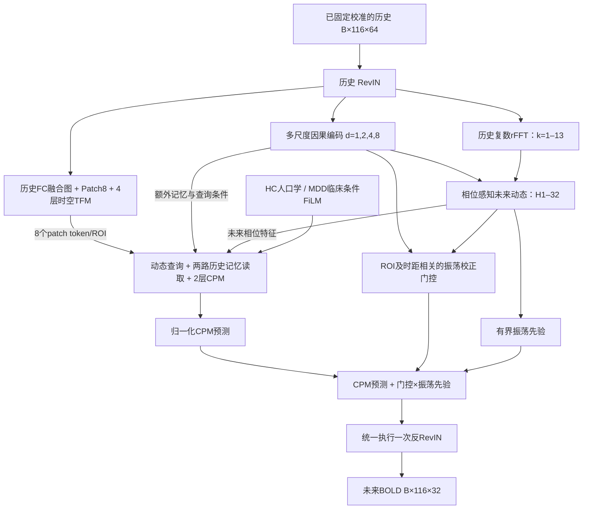

# 当前多尺度相位模型结构

本文描述已经完成HC→MDD训练及测试的实验模型，配置为 `configs/neurotwin_multiscale_phase.json`。它与原方案B共用 `NeuroTwinTFM` 类，新增路径由配置启用；原 `configs/neurotwin.json` 仍保留为默认正式B配置。本次没有将实验模型自动替换为全局默认模型。

## 数据与整体路径

TR=2秒。数据侧使用同一扫描最早32TR的固定均值/尺度进行校准，截取过去64TR，预测未来32TR。校准使用扫描前缀，RevIN只使用当前可见历史，均不使用预测锚点后的观测。

## 保留的TFM与功能图

| 项目 | 当前实现 |
|---|---|
| 图输入 | 当前64TR历史的绝对FC；不读取未来或真实未来FC |
| 图融合 | 原历史FC、可学习低秩图及对称Sinkhorn，配置rank=12 |
| Patch | 每8TR一组，每ROI产生8个256维token |
| 时空编码 | 4层；每层包含RMSNorm、ROI内因果时间注意力、图引导ROI注意力及FFN残差 |
| 注意力 | 4头，每头64维；FFN宽度1024 |
| 输出 | 历史token `[B,116,8,256]`；原8个token不替换 |

代码模块仍名为 `SoftAnatomicalPrior`，本实验传入的是历史功能连接图，不能据模块名称将其解释为新增DTI输入。

## 多尺度历史状态

`MultiScaleTemporalEncoder` 接收RevIN后的 `[B,116,64]`，所有ROI共享时间投影和卷积权重。先从1通道投影到64通道，经过kernel=3、dilation=1/2/4/8的四个残差块；归一化仅沿通道，卷积仅左填充。

最终拼接输入投影和四个尺度各自的最新状态，以及末层完整64TR特征均值，再投影到256维，得到 `[B,116,256]`。最新状态的卷积感受野为31个TR，完整历史聚合补充更长上下文。这里是可学习尺度表示，不宣称分出了统计独立的固定频带。

实际卷积用左移窗口和线性投影计算，数学上等价于原Conv1d；保留Conv1d参数名、形状和确定性设置。该实现避免确定性CuDNN在大ROI批量上的慢路径，四种dilation的双精度输出及全部输入/参数梯度等价检查通过。

## 相位感知未来状态

`PhaseAwareForecast` 只对当前64TR历史做rFFT，候选频点k=1–13覆盖0.0078125–0.1015625 Hz。输入特征包含复数实部/虚部、幅值、单位相位的实部/虚部和频点位置，多尺度状态共同决定模式参数。

FFT系数以历史首帧为原点，先旋转63帧到历史末帧，再从h=1开始外推。小范围频移限制为±半个bin（±0.00390625 Hz）；幅值调制限制在0.5–1.5内，模式可靠性随时距衰减。不可靠模式可被降低，不假设历史周期会永远延续。可靠性是学习的门控权重，不是经过校准的未来置信概率。

输出为未来相位特征 `[B,116,32,256]` 和归一化振荡先验 `[B,116,32]`。现有TFM保留全时间域信息，未把中快尺度直接过滤掉，也未将离线db4分解作为模型输入。

## CPM查询、记忆与输出融合

每个未来查询保留ROI embedding和horizon embedding，并叠加多尺度状态投影、目标时距的相位特征投影，之后接受原条件FiLM。两项动态查询投影的残差系数初始为0.01。

两层CPM都能读取两组历史记忆：原patch记忆共928个token，以及每ROI一个多尺度token共116个。所有ROI的未来查询共3712个，均可读取历史记忆；不是每个ROI只访问自身8个patch。

两组记忆共享Q/K/V投影，分别执行交叉注意力，再以初始logit=-6的全局小门控做残差相加。这是独立softmax的实现变体，**不等同于把全部token放进同一次softmax**；它保留原patch记忆的归一化并支持Flash Attention。

最终振荡校正门控与上述记忆门控不同：它由多尺度状态、未来相位特征及时距共同产生，形状为 `[B,116,32]`，初始偏置为-4。CPM预测与门控后的振荡先验在同一RevIN空间相加，之后统一执行一次反RevIN。没有教师强制或真实未来反馈，也没有独立单步预测头；H1由同一H32预测截取。

## 参数量与公开接口

| 部分 | 参数量 |
|---|---:|
| 多尺度编码器 | 165248 |
| 相位预测模块及最终校正门控 | 97030 |
| CPM动态查询及额外记忆适配器 | 197379 |
| 新增合计 | 459657 |
| HC模型总量 | 6315384（原B为5855727） |
| MDD模型总量 | 6326104（原B为5866447） |

新增参数约占原模型的7.8%，未增加完整Transformer主干。HC和MDD的差异来自原有临床条件编码。

- 内部前向：`model(x, condition)`，`x=[B,116,1,64]`，返回预测 `[B,116,32]` 和aux。
- 公开预测：`forecast_horizon(history, condition)`，已固定校准的 `history=[B,64,116]`，返回 `[B,32,116]`。
- `return_tokens=True` 额外返回历史token、多尺度状态、相位特征、振荡先验及校正门控。
- `model.load_model_checkpoint(path)` 按checkpoint完整参数和条件统计量严格重建；`model.build_model(config_path=...)` 同时核对配置及已登记哈希。

## 当前实际选中的模型

HC与MDD都训练到第22轮早停，第11轮起确实执行了解冻联合训练；两者best均为第10轮的EMA权重。因此当前用于测试的最佳模型来自冻结阶段末，不能把结果描述成“解冻后的主干获得了提升”。

新模块在冻结阶段已经参与优化；MDD继承新HC best的多尺度/相位参数和HC共享字段统计量。默认B、数据切分和原权重继续保留。完整结果见[实施结果总结](../../results/模型优化/多尺度相位预测_20261107/说明/实施结果总结.md)，命令见[实施说明](多尺度相位预测实施说明.md)。
