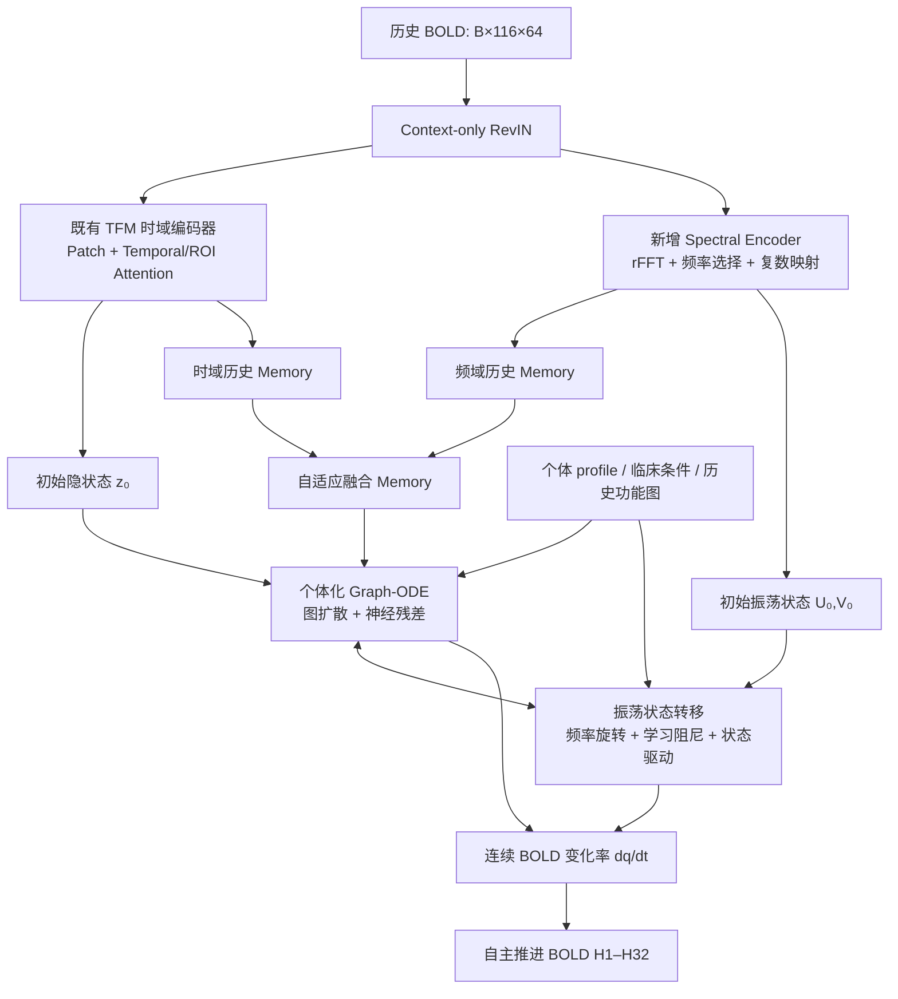

# NeuroTwin 长程预测优化方案：借鉴 FEDformer 的频域增强与连续动力学建模

> **文档类型**：模型优化与实验设计  
> **日期**：2026-11-02（上海时间）  
> **适用项目**：[NeuroTwin](https://github.com/xlongwu/NeuroTwin)  
> **参考论文**：Zhou et al., *FEDformer: Frequency Enhanced Decomposed Transformer for Long-term Series Forecasting*, ICML 2022  
> **方案状态**：待实施；本文提出的改造尚未在 NeuroTwin 上验证  
> **主要任务**：提升个体 rs-fMRI BOLD 序列在 **H1–32（重点 H17–32）** 的多步自主预测精度，缓解振幅收缩、隐状态同质化和长期时间对应关系减弱，同时保留个体化、图约束和连续动力学建模能力。

---

## 1. 结论与技术路线

**不整体替换为 FEDformer。** NeuroTwin 需要连续状态演化与个体化数字孪生，而 FEDformer 的核心优势是长序列的频域表示与非自回归多步预测，两者目标并不完全相同。

建议构建 **Frequency-Conditioned Graph-ODE（频域条件增强的图神经 ODE）**，保留现有 TFM Encoder、历史功能图、个体 profile、条件注入、Graph-ODE 与 Heun 积分；增加：

1. **Spectral Memory（频域历史记忆）**：参考 FEDformer Frequency Enhanced Block，从真实历史 BOLD 提取保留幅度和相位的频域特征，与时域记忆融合。
2. **Evolving Spectral State（可演化的频率状态）**：在 Graph-ODE 持续推进时同步更新有阻尼的振荡状态，使频域信息不仅在初始时刻提供条件，也能持续作用于未来 BOLD 变化率。
3. **完整 H32 自主推进监督**：恢复 H1–32 训练、选模和评估；在同一长期预测基线上比较频域编码与振荡状态的贡献。
4. **按预测阶段组织训练损失**：在前面结构改造完成后，研究 H1–8、H9–16、H17–32 的精度平衡。

模型始终保持从**同一个真实历史锚点**出发连续自主推进；不以未来真实观测刷新隐状态，也不将直接多步预测头替代 Graph-ODE 主预测路径。

---

## 2. 当前代码与证据基线

### 2.1 当前仓库模型结构

截至本方案整理时，仓库的正式配置为 `configs/neurotwin.json`，当前主线只监督与评估 H1–8；H9–32 相关训练/评估入口已从当前正式协议中移除。

| 组成 | 当前实现 | 相关位置 |
|---|---|---|
| 历史输入 | K=64、116 ROI，raw BOLD，RevIN | `models/tfm.py`、`models/common.py` |
| 时域编码 | Patch 长度 8；因果 Temporal Attention + 图引导 ROI Attention | `models/tfm_backbone.py` |
| 初始隐状态 | 取编码器最后一个 patch token：`z_t = tokens[:, :, -1, :]` | `models/tfm.py::_initial_latent` |
| 图来源 | 历史 BOLD 的功能连接 `history_fc`；学习得到有效图先验 | `models/tfm.py::_history_fc_adj`、`models/graph_prior.py` |
| 个体化 | 最早 32 TR 校准得到 profile；PersonalFiLM 调节向量场 | `models/tfm_personal.py` |
| 图动力学 | Graph-ODE，Heun RK2，每 TR 两个积分子步 | `models/tfm_dynamics.py` |
| 历史记忆 | 已观测历史 token 的 patch 均值；自主推进阶段固定 | `models/tfm.py::_history_memory` |
| BOLD 输出 | 由 latent 预测变化率，再积分更新 BOLD 状态 | `models/tfm_dynamics.py::_rate` |
| 当前损失 | 重建 L1 + FC MSE + rFFT 幅度 L1；同方差不确定性加权 | `train/losses.py::ForecastFidelityLoss` |
| 当前选模 | H1–8 被试级 MAE + 8 步 FC MSE | `main.py` |

**关键实现细节：**

- `rollout_next_states()` 与 `advance_state()` 仍保留了“初始化一次、随后逐步推进”的模型接口；但当前正式训练配置限制为 H1–8。
- `initialize_state()` 存储 `z`、`q`、`adj`、`cond`、`profile`、`memory`、`norm_stats` 等状态。
- 自主推进时，图、个体 profile、临床条件、RevIN 统计量与已编码历史记忆固定；不反复将预测序列回送编码器。
- 当前有效图基于可见历史的 FC，不应无依据地写为独立测量的解剖 SC。

### 2.2 已有长期退化证据

以下数据来自仓库 `docs/实验结论与证据汇总.md` 的**历史 H32 实验**，不是当前 H1–8 checkpoint 的新测试结果。

| 现象 | 历史结果 | 含义 |
|---|---:|---|
| H17–32 时间 PCC | 约 0.1762 | 远期时间轨迹与真实信号对应较弱 |
| H17–32 预测/真实时间标准差比 | 约 0.1995 | 预测动态幅度显著收缩 |
| H17–32 MAE | 0.896604（历史 test） | 相对历史均值基线优势有限 |
| 历史均值 MAE | 0.922955（历史 test） | 远期点预测接近平均水平 |

另有历史同预算监督比较（**val**，同架构、BS64、150 轮）：

| 监督范围 | H1–8 MAE | H9–16 MAE | H17–32 MAE | H1–32 MAE |
|---|---:|---:|---:|---:|
| 只监督 H1–8 | 0.518874 | 1.088723 | 1.822502 | 1.313150 |
| 完整监督 H1–32 | 0.519091 | 0.857499 | 0.898595 | 0.793445 |

**已获得的可靠决策依据**：长程精度依赖完整长程监督；不能只训练 H1–8 后，期待结构改造自动修复 H17–32。

此外，仓库已有频域监督小规模配对初筛：远期时间 PCC 频域臂约 `0.183402`，控制臂约 `0.182752`，原 ODE 约 `0.191393`。这不支持简单增大已有 FFT 幅度 Loss 的权重，应优先探索**频域表征及状态结构**。

### 2.3 明确待解决的问题

- **P1：动态振幅收缩。** 随预测跨度增加，预测轨迹的时间变化逐渐缩小。
- **P2：状态演化区分度下降。** Graph-ODE 的长程传播可能出现过度平滑、条件均值化或隐状态差异收缩；具体原因尚未唯一确定。
- **P3：远期相位/时间对应不足。** 模型可能得到合理的边际统计量，但不能精确对应真实未来波动。
- **P4：训练目标不匹配。** 当前正式配置只评估 H1–8，不再以 H17–32 优化模型。

区分两种性质：预测**点误差**改善与预测**轨迹动力学**改善不等价；频谱匹配也不自动保证真实未来相位正确。

---

## 3. 借鉴 FEDformer：适用机制与不采用机制

FEDformer 对长程预测的主要做法包括趋势—季节分解、频域增强模块（FEB）、频域增强注意力（FEA）以及一次前向的多步预测。NeuroTwin 的取舍如下。

| FEDformer 机制 | NeuroTwin 取舍 | 原因 |
|---|---|---|
| Frequency Enhanced Block | **借鉴** | 使长期/周期特征显式进入历史表征 |
| Frequency Enhanced Attention | 暂不优先 | 当前 K64、patch_len=8，仅约 8 个 patch；复杂频域注意力的收益不确定 |
| 多尺度趋势—季节分解 | 暂不直接引入 | rs-fMRI 的低频神经波动可能被移动平均当作趋势滤除 |
| 非自回归 Direct Multi-step | 可做辅助对照 | 规避显式自回归误差传播，但不保证自主动力学稳定 |
| 频域整段重建 | 保留为辅助指标/损失候选 | 频谱形状相近不等于未来波形相位一致 |

**关键创新方向**：由“静态频域历史特征”拓展为“与 Graph-ODE 同步演化的频率动态状态”，而非仅在输出端叠加频谱 Loss。

---

## 4. 目标模型结构

约束：图、个人 profile、条件及历史编码来自预测锚点之前的观测；预测时不访问未来真值。

### 4.1 原始状态变量

每名被试的预测状态记为：

\[
S_h=(Z_h,q_h,A,p,c,M),
\]

其中：

- \(Z_h\in\mathbb R^{B\times F\times D}\)：Graph-ODE 隐状态，当前 \(D=256\)。
- \(q_h\in\mathbb R^{B\times F}\)：RevIN 空间的当前 BOLD 状态。
- \(A\in\mathbb R^{B\times F\times F}\)：由可见历史推导的有效功能图，预测时固定。
- \(p\)：个体校准 profile；\(c\)：条件编码；\(M\)：真实历史记忆。

原 Graph-ODE 主体概括为：

\[
\frac{dZ}{dt}=-\kappa L_AZ+\rho R_\theta(Z,A,c,p,M),\qquad \rho=0.1.
\]

\[
\frac{dq}{dt}=W_yZ+b_y.
\]

这里省略了当前实现中的可选控制项和可选反馈项，实际修改应保持其原有开关语义。

---

## 5. 模块 A：Spectral Memory（频域历史编码）

### 5.1 输入与频率范围

对归一化后的历史 BOLD：

\[
X\in\mathbb R^{B\times F\times K},\qquad K=64,\ F=116.
\]

按每个 ROI 的时间维执行实数 FFT：

\[
\widetilde X=\operatorname{rFFT}(X,\mathrm{dim}=-1)\in\mathbb C^{B\times F\times (K/2+1)}.
\]

在 TR = 2 s、K = 64 下：

- 采样频率为 0.5 Hz，Nyquist 为 0.25 Hz。
- 频率分辨率为 \(\Delta f=1/(K\cdot TR)=0.0078125\) Hz。
- rFFT 包含 33 个非负频率 bin。
- 可以先在 **0.01–0.10 Hz** 范围内选取候选 bin（约第 2–12 个 bin，0.015625–0.09375 Hz），再由数据学习其贡献；该范围不是强制滤波界限。

**不要照搬 FEDformer 默认的 64 个 Fourier modes**：当前输入长度不足以提供相同数量的独立非负频率分量。也不应只取幅值，因为振荡的相位直接影响未来时间点的预测。

### 5.2 特征映射

对候选频率系数保留实部、虚部：

\[
E_f=[\Re(\widetilde X_f),\Im(\widetilde X_f)].
\]

用共享线性映射或轻量复数映射得到：

\[
H_f=\phi(W_f E_f+b_f),\qquad
M_{\mathrm{freq}}=\operatorname{FreqAggregate}(H_f).
\]

建议输出为 \([B,F,D]\)，与现有按 ROI 的时域历史记忆对齐。频率选择应可学习，但其权重不能依赖未来真实数据。

### 5.3 与现有时域记忆融合

现有 `_history_memory(tokens)` 通过 patch 维均值池化得到 \(M_{\mathrm{time}}\in\mathbb R^{B\times F\times D}\)。

建议融合：

\[
G_m=\sigma\!\left(W_g[M_{\mathrm{time}};M_{\mathrm{freq}}]+b_g\right),
\]

\[
M=M_{\mathrm{time}}+G_m\odot W_m M_{\mathrm{freq}}.
\]

采用近零初始化的新增分支，确保训练起点尽量接近已有模型的记忆语义。`M` 继续传给 `GraphODEDynamicsHead` 的 `memory_film`，不重新编码每一步的预测 BOLD。

### 5.4 修改位置

- `models/tfm_backbone.py`：新增 `SpectralMemoryEncoder`。
- `models/tfm.py`：在 `_encode()` 或模型初始化阶段接入频域分支；在 `_history_memory()` 融合。
- `configs/neurotwin.json`：新增独立可配置的 `spectral_memory` 参数，不能改变当前正式 H1–8 权重的加载结构。

建议起点：候选频率带 `0.01–0.10 Hz`；输出维度 `D=256`；一个轻量频率聚合层；残差门控初始接近零。参数以实验配置为准。

---

## 6. 模块 B：Evolving Spectral State（可演化振荡状态）

这是本方案**优先级最高的结构改动**：不仅在初始状态时利用频谱，而且每推进一个 TR，就同步推进频率状态。

### 6.1 扩充预测状态

将原状态增加振荡分量：

\[
S_h=(Z_h,q_h,U_h,V_h,A,p,c,M),
\]

其中 \(U_h,V_h\in\mathbb R^{B\times F\times M_f}\)，\(M_f\) 为选定频率模式数量，初始值由历史 rFFT 的实部、虚部映射获得。

为避免符号冲突：本文的 \(M\) 表示时域/频域融合历史记忆，\(M_f\) 表示频率模式数。

### 6.2 带阻尼的频率旋转状态更新

对每个选定频率 \(\omega_m=2\pi f_m\)，使用有阻尼的旋转演化：

\[
\begin{bmatrix}U_{m,h+1}\\V_{m,h+1}\end{bmatrix}
=e^{-\gamma_m\Delta t}
\begin{bmatrix}
\cos(\omega_m\Delta t)&-\sin(\omega_m\Delta t)\\
\sin(\omega_m\Delta t)&\cos(\omega_m\Delta t)
\end{bmatrix}
\begin{bmatrix}U_{m,h}\\V_{m,h}\end{bmatrix}
+\mathcal B_m(Z_h,p,c)\Delta t.
\]

其中：

- \(\gamma_m=\operatorname{softplus}(\bar\gamma_m)\ge0\)，学习每种模式的阻尼。
- \(\mathcal B_m\) 是由当前 latent、个体 profile、临床条件产生的轻量驱动项。
- 对每一步 \(\Delta t=1\) TR；在离散旋转矩阵中应使用“弧度/每 TR”的一致单位。如果 \(f_m\) 用 Hz 表示，应采用 \(\omega_m=2\pi f_m\cdot TR\) 并令 \(\Delta t\) 为 TR 数；不要重复乘 TR。
- 频率状态初值只依赖锚点前的历史。

**注意**：上式是待实施的候选神经动力学结构，并非 FEDformer 原论文已有的模块。

### 6.3 与 Graph-ODE 双向耦合

保留当前图扩散、残差和个体调制机制，在 BOLD 变化率读出中加入频率驱动：

\[
\frac{dq}{dt}
=\underbrace{W_yZ+b_y}_{\text{原主干}}
+\underbrace{g(Z,p,c)\odot W_o U}_{\text{频率动态补偿}}.
\]

其中 \(g\) 是逐 ROI 或逐通道门控；\(W_o\) 为轻量线性读出。为保证改造起点与原模型接近，新增补偿读出可以零初始化，随后在长程监督中学习。

可选地，将振荡状态编码成向量场的附加驱动：

\[
\frac{dZ}{dt}
=-\kappa L_AZ+\rho R_\theta(Z,A,c,p,M)
+\eta\,W_z[U,V].
\]

这里建议先实现 `q` 读出驱动，再在同一模块里提供 `Z` 驱动开关；主要对照仍由整体结构 E0–E3 完成，不必衍生大量细碎实验。

### 6.4 推进时的一致性

- `GraphODEDynamicsHead.integrate_interval()` 当前使用 Heun RK2 同步更新 \(Z\) 与 \(q\)。引入 \(U,V\) 后需保证四种状态在每个预测区间按统一的时间尺度演化。
- 可以在区间内使用精确旋转/阻尼更新与 ODE 步的算子组合；若频率驱动影响 \(q\) 和 \(Z\)，应保持相同的 stage 时间定义，避免新状态与 Heun 中间态错位。
- `initialize_state()` 初始化频率状态，`advance_state()` 输出其下一状态；`rollout_next_states()` 自然重复调用这一更新。频率状态不应在每一步从预测 BOLD 重新做 FFT 计算。
- 目前固定的历史图、profile、条件、RevIN 统计量仍保持原语义，除非后续另立独立的动态图方案。
- 振幅不能被硬性设为常数：允许学习阻尼，避免凭空制造永不衰减的周期信号。

### 6.5 修改位置

- `models/tfm_dynamics.py`：新增 `SpectralOscillator`，支持初态构建、阻尼旋转、latent 驱动及频率状态读出；扩展 `integrate_interval()` 的状态推进。
- `models/tfm.py`：在 `initialize_state()` 加入 `osc_u`、`osc_v`；在 `advance_state()` 和 `forward()` 中维护并传播；确保 `rollout_next_states()` 可持续使用同一频率状态。
- `models/tfm_personal.py`：保留现有 profile 编码，仅将 `profile` 作为振荡驱动条件，不新建受试者 ID embedding。

---

## 7. 训练方案：恢复 H32 自主推进监督

### 7.1 必须恢复的训练能力

当前 `main.py` 将动态 horizon 固定为 8，训练脚本亦显式限制 `CPM_HORIZON=8`。因此独立的 H32 方案必须恢复：

1. 从每名被试的真实 K64 历史锚点开始，输出 H1–32 的完整 Graph-ODE 自主推进轨迹。
2. 数据加载器提供完整的 `future`、`future_mask`、校准前缀及合法的连续 H32 锚点。
3. `main.py` 将长期配置的 `horizon` 同时传入数据、预测、Loss 和验证，取消仅面向正式 H1–8 分支的硬编码限制。
4. 以完整 H1–32 指标选优，并单独报告 H1–8、H9–16、H17–32。
5. HC 预训练与 MDD 微调保持一致的 horizon 语义；使用独立输出目录，不覆盖现有 H1–8 checkpoint。

这属于**重新启用长期研究分支**，不要修改当前 H1–8 正式结果或将旧指标当成新权重的测试结果。

### 7.2 基础损失：先保持已有三项损失一致

当前实现已有：

\[
\mathcal L_{\mathrm{fidelity}}
=\lambda_{\mathrm{rec}}\mathcal L_{\mathrm{rec}}
+\lambda_{\mathrm{FC}}\mathcal L_{\mathrm{FC}}
+\lambda_{\mathrm{freq}}\mathcal L_{\mathrm{freq}},
\]

其中：

- 重建损失为未来轨迹的 MAE；
- FC Loss 为未来预测/真值 Pearson FC 矩阵的 MSE；
- 频域 Loss 为未来序列正交 rFFT **幅度** L1（它不直接监督未来相位）；
- 当前默认使用可学习同方差不确定性权重，实际公式和有效权重见 `train/losses.py`。

**实验 E0、E1、E2 应保持同一基础 Loss 与训练预算**，从而将增益主要归因于架构变化，而不是混合了 Loss 调整。

### 7.3 分阶段监督（E3）

在 E2 结构已实现后，进一步比较按不同 horizon 分组的重建损失：

\[
\mathcal L_{\mathrm{rec,stage}}
=0.3\,\mathcal L_{1:8}
+0.3\,\mathcal L_{9:16}
+0.4\,\mathcal L_{17:32},
\]

每个阶段先按其有效 ROI、时间和被试求平均，避免 H17–32 仅由于时间点较多获得额外权重。上述 `0.3/0.3/0.4` 仅是实验起点，不是已有最优系数。FC 与频谱项保持 E2 方式，其他设置不变。

若 E3 只改善 H17–32 MAE，却大幅损害 H1 或整体时间 PCC，则应保留 E2，而非继续进行无约束的权重穷举。

### 7.4 数据语义与迁移策略

- 数据：Rest-meta-MDD 的同一被试级划分；HC 训练学习共享健康动力学，MDD 微调保留共享主干与个体/疾病条件差异。
- 个体 profile 仍只由真实历史最早校准前缀得到；未来真值不得进入 profile、图或历史记忆。
- HC 预训练和 MDD 微调必须使用同一新架构定义；新增的频率状态模块在 HC 预训练中学习基础规律，MDD 微调时学习适配，而不是独立在 MDD 中随机初始化后仅训练少量轮次。
- 建议沿用原模型的冻结—解冻逻辑与学习率分组；新增模块应在 HC 阶段可训练，并在 MDD 解冻策略中明确其归属。

---

## 8. 实施任务与代码修改清单

| 文件 | 修改内容 | 实施结果 |
|---|---|---|
| `models/tfm_backbone.py` | 实现频域历史特征编码、频率选择、相位保留 | 输出 `[B,F,D]` Spectral Memory 和初始频率参数 |
| `models/tfm.py` | 创建频域分支；融合两路历史记忆；扩充 `initialize_state`、`advance_state`、`forward` | 支持频域增强的自主 H32 轨迹 |
| `models/tfm_dynamics.py` | 新增振荡状态与 BOLD rate 补偿，同步积分推进 | `z/q/u/v` 在 H32 上连续可微演化 |
| `train/losses.py` | 保留原重建/FC/频谱损失，新增可选的分阶段重建项 | E0–E3 可配置、可复现 |
| `main.py` | 恢复可配置的动态训练 horizon、完整长期验证和选模 | 支持 H32 训练与模型选择 |
| `scripts/pretrain.sh`、`scripts/finetune.sh` | 在独立 H32 配置下移除 H8 限制 | 可独立训练 HC H32、MDD H32 |
| `configs/neurotwin.json` | **不覆盖当前正式配置**；新建独立长程实验配置（建议 `configs/neurotwin_h32_spectral.json`） | H1–8 与 H32 配方隔离 |
| `analysis/evaluate.py`、相关评估代码 | 恢复固定锚点 H32 自主推进指标、频谱/FC、逐 horizon 统计 | 同协议结果表及可视化 |

**实施顺序**：先恢复 H32 能力并训练 E0 基线；随后一次性完成 Spectral Memory、Spectral Oscillator 与完整训练接线，按 E1/E2/E3 运行对照。不要额外建立阻碍训练的多轮人工审核步骤；仅保留能确保计算图连通、形状正确、无未来泄漏和 checkpoint 可加载的必要检查。

---

## 9. 消融与实验协议

### 9.1 四组主实验

| ID | 模型结构 | 损失 / 训练 | 回答的问题 |
|---|---|---|---|
| **E0** | 当前 Graph-ODE + 现有历史记忆 | 恢复完整 H32；原三项 Loss | 现行代码条件下的有效长期基线 |
| **E1** | E0 + Spectral Memory | 与 E0 完全一致 | 显式频域历史表示是否有帮助？ |
| **E2** | E1 + Evolving Spectral State | 与 E0/E1 完全一致 | 持续频率状态是否缓解振幅和远期精度退化？ |
| **E3** | 与 E2 相同 | 分阶段 H1–8 / H9–16 / H17–32 重建监督 | 是否能改善短—中—远期精度平衡？ |

控制条件：相同被试划分、可比训练预算、随机种子、预处理、K64、评估锚点、优化器和相同 Loss 口径（E3 的目标调整除外）。E0 必须基于现行代码重新训练；历史已经删除的 H32 checkpoint 只能作为历史参考，不得伪称受控对照权重。

### 9.2 评价任务及聚合口径

固定锚点从真实的 K64 历史出发，连续自主预测 H1–32，全程不反馈未来观测。指标先在被试内部聚合，再跨被试等权，避免长序列被试或锚点更多者占据更高权重。

| 类别 | 核心指标 | 主要用途 |
|---|---|---|
| 预测误差 | H1、H1–8、H9–16、H17–32、H1–32 MAE / RMSE | 是否真正在长程取得精度提升 |
| 轨迹对应 | H17–32 时间 PCC；逐 horizon PCC | 是否追踪到真实未来振荡，而非仅靠均值最小化误差 |
| 振幅 | 预测/真实时间标准差比；逐 ROI 分层 | 是否减轻动态幅度收缩 |
| 短期变化 | 一阶差分 PCC、方向准确率 | 是否保留状态转移方向 |
| 自相关 | lag-1 ACF 差异 | 是否保留时序依赖 |
| 频谱 | PSD shape r、log-PSD MAE | 频域统计是否更合理 |
| 网络 | H32 的 FC MSE、FC 边向量 PCC | 是否保留 ROI 间功能耦合结构 |

**最重要的联合判断**：E2 相比 E0 是否同时改善 H17–32 MAE 与时间 PCC，并使振幅比向 1 接近。若只是振幅回升但 MAE / 时间 PCC 恶化，则不能视为长程预测成功。

### 9.3 关键结果解读

- **E1 提升、E2 进一步提升**：说明频域信息不仅对初始化有用，持续参与状态推进也有收益。
- **E1 提升、E2 无提升**：频域历史表征有用，但显式振荡状态的归纳偏置或耦合方式不适合当前数据。
- **E1 无提升、E2 提升**：单纯增加历史频域特征不足，显式状态演化可能才是主要贡献；需谨慎解释两者串联产生的作用。
- **E2 振幅改善但 MAE/时间 PCC 无提升**：可能只恢复了无相位对应的周期波动，不能称为真正的长程精度提升。
- **E3 远期改善、近期退化**：存在损失阶段权衡，不应只报告 H17–32 的单项结果。
- **整体无提升**：说明主要限制可能来自短程 BOLD 可预测性、未来随机性、数据质量或其他状态动力学缺陷，而非仅频域表征缺失。

---

## 10. 不建议的做法与技术边界

1. **不直接用 FEDformer 替换 Graph-ODE。** 直接多步输出可以作为辅助基线，但不符合 NeuroTwin 对可连续模拟状态的核心需求。
2. **不直接复制 64 个 Fourier modes。** K64 只有 33 个非负频率 bin，且 TR=2 s 的频谱语义不同于工业数据。
3. **不直接对 BOLD 作强移动平均去趋势。** 生理低频振荡可能被移除，削弱疾病相关信号。
4. **不只增加频域 Loss 权重。** 历史初筛未证明该操作能显著提升远期时间对应。
5. **不强制生成等幅周期振荡。** 未来 BOLD 具有随机性；应学习阻尼和驱动，防止虚假生理振荡。
6. **不将 FC/PSD 匹配等同于轨迹准确。** 功率谱、均值或边际分布相似也可能具有错误的时域相位。
7. **不混淆当前 H1–8 与历史 H32 结果。** 不同权重、预算、范围的结果不能直接归因为新结构提升。
8. **不宣称生成结果具有真实刺激效应或临床因果意义。** 当前研究缺少真实扰动和纵向验证；学习的功能图不等于测得的白质 SC。

---

## 11. 交付物与最终判据

### 11.1 代码与配置

- 独立 H32 配置，不改变现有 H1–8 研究配方和 checkpoint。
- `SpectralMemoryEncoder`、`SpectralOscillator` 和 Graph-ODE 状态耦合代码。
- HC 预训练与 MDD 微调均能完成从真实历史出发的 H32 自主预测。
- E0–E3 四组完整实验的代码、配置和对应 checkpoint。

### 11.2 数据与结果

- E0–E3 统一协议的指标表：逐被试、逐 horizon、短/中/长三阶段。
- 主要可视化：真实与预测 BOLD 轨迹、远期 MAE/PCC 曲线、时间标准差比、PSD 曲线与 FC 差异图。
- 提供训练曲线、实验配置和可复现实验命令。

### 11.3 最终选择原则

按以下顺序判断是否采用新模型：

1. **H17–32 MAE 与时间 PCC 是否有一致收益**，同时报告 H1 与 H1–32 总体表现。
2. 预测幅度比、差分和 ACF 是否更接近真实信号，而不是人工放大预测波动。
3. FC 和 PSD 是否未出现明显退化。
4. 个体化 profile、临床条件和历史功能图机制是否仍正常参与动力学建模。

**预期科研贡献方向**：将 FEDformer 式频域建模从静态历史特征扩展为可持续演化的、个体条件化的 Graph-ODE 振荡状态，为脑 BOLD 的长程预测提供频域—图动力学耦合的候选实现。其有效性以 E0–E3 的实际训练与独立测试为准。

---

## 12. 参考资料

1. Zhou, T. et al. **FEDformer: Frequency Enhanced Decomposed Transformer for Long-term Series Forecasting**. ICML, 2022. 论文：https://proceedings.mlr.press/v162/zhou22g.html ；代码：https://github.com/MAZiqing/FEDformer
2. NeuroTwin GitHub：https://github.com/xlongwu/NeuroTwin
3. NeuroTwin 当前范围说明：`docs/项目状态与工作范围.md`
4. NeuroTwin 历史长期实验：`docs/实验结论与证据汇总.md`
5. NeuroTwin 模型实现：`models/tfm.py`、`models/tfm_backbone.py`、`models/tfm_dynamics.py`、`models/tfm_personal.py`
6. NeuroTwin 损失与训练：`train/losses.py`、`main.py`、`scripts/pretrain.sh`、`scripts/finetune.sh`

> **说明**：本方案在不改动用户仓库的前提下整理成 Markdown，可作为 Codex 开发任务的方案源文档。本文中 E0–E3 是待运行的新实验，所有“当前/历史”数值均按对应仓库文档的时间与协议标记。
